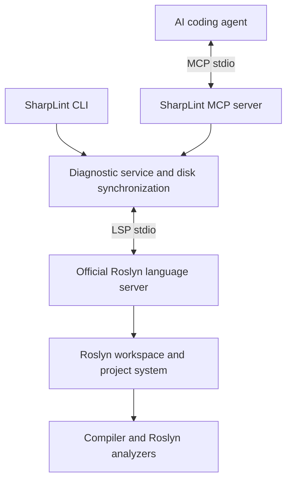

# SharpLint

SharpLint is a local, read-only bridge from Microsoft's Roslyn language server to AI coding agents. It exposes compiler and ordinary Roslyn analyzer diagnostics through MCP stdio and a CLI, with one shared diagnostic service.



SharpLint does not construct compilations, load an MSBuild workspace, execute analyzers itself, or install packages into user projects. Roslyn owns those operations. The old DSL libraries remain available as legacy APIs; the diagnostic service does not load `sharplint.config.cs` or use SharpLint analyzer modules.

## Requirements and installation

- Build SharpLint with the SDK in `global.json`: .NET **10.0.202**, with `latestMinor` roll-forward.
- Run with .NET **10**. The tested Roslyn server also requires .NET 10.
- Install the [official Roslyn language server](https://github.com/dotnet/roslyn/blob/main/src/LanguageServer/roslyn-language-server/README.md). The tested version is pinned below; other versions must support the protocol described in [the service contract](docs/lsp-service.md).
- Restore the target solution's dependencies yourself. SharpLint disables Roslyn's automatic package restore.

```sh
dotnet tool install --global roslyn-language-server --version 5.13.0-1.26514.10
mkdir -p packages
dotnet build SharpLint.slnx -m:1
dotnet pack src/SharpLint.Cli -c Release -o artifacts/packages
dotnet tool install --global sharplint --version 0.2.0-alpha --add-source ./artifacts/packages
```

Use trusted projects: loading projects through Roslyn evaluates MSBuild and may run project build logic. SharpLint does not modify source files or apply language-server edits.

## MCP

Configure your MCP client with an absolute workspace path:

```json
{
  "mcpServers": {
    "sharplint": {
      "command": "sharplint",
      "args": ["mcp", "--workspace", "/absolute/path/to/repository"],
      "env": {
        "SHARPLINT_ROSLYN_PATH": "/absolute/path/to/roslyn-language-server"
      }
    }
  }
}
```

During development, use `"command": "dotnet"` and prepend the absolute path to `src/SharpLint.Cli/bin/Debug/net10.0/sharplint.dll` to `args`. Logs go to stderr; stdout carries only MCP messages. SharpLint uses the [official C# MCP SDK](https://github.com/modelcontextprotocol/csharp-sdk).

There are two tools:

- `sharplint_check(path?)`: reconcile disk and request diagnostics. An omitted path checks C# documents recursively under the workspace root, excluding generated sources in `bin` and `obj`. A path selects a file or directory inside that root.
- `sharplint_status()`: initialize or inspect Roslyn availability, project loading, diagnostic capabilities, session/process identity, errors and limitations.

The MCP process keeps one Roslyn session warm. Source edits reuse that session; changes to project inputs or the source file set cause a bounded session reload. Checks run serially with cancellation and a deadline that includes time waiting in the queue.

## CLI

```sh
sharplint check
sharplint check src/Example.cs
sharplint check --path ./src --format json
sharplint check src/Example.cs --workspace /path/to/repo --solution Example.slnx
sharplint status --format json
sharplint mcp --workspace /path/to/repo --timeout 120
```

`--server` selects an executable or language-server DLL. Otherwise discovery uses `SHARPLINT_ROSLYN_PATH`, `PATH`, then the default .NET global tool directory. `--workspace` defaults to the current directory; for compatibility, a directory passed to `check --path` also becomes the workspace if none is explicit. With one root solution, Roslyn auto-loads it; use `--solution` when several exist. A root without a solution uses Roslyn's automatic C# project discovery (maximum 500 projects).

Every separate CLI invocation has a cold language-server startup. Separate CLI processes do not share a warm workspace.

Exit codes: **0** = complete document check with no error-severity diagnostics, **1** = complete document check with diagnostic errors, **2** = incomplete, timed out, failed or invalid request, **130** = cancelled. Warnings do not cause exit code 1. `status` uses 0 for an available diagnostic session and 2 for failures.

## Ordinary and custom analyzers

Use normal .NET project configuration and `.editorconfig`:

```xml
<PropertyGroup>
  <EnableNETAnalyzers>true</EnableNETAnalyzers>
  <AnalysisLevel>latest</AnalysisLevel>
</PropertyGroup>
<!-- For a custom analyzer built as part of your solution: -->
<ItemGroup>
  <ProjectReference Include="../MyAnalyzer/MyAnalyzer.csproj"
                    OutputItemType="Analyzer" ReferenceOutputAssembly="false" />
</ItemGroup>
```

```ini
[*.cs]
dotnet_diagnostic.CA1822.severity = warning
```

NuGet analyzer package references work through the same native Roslyn project integration. Build custom analyzer projects and restore packages before checking. SharpLint does not need an analyzer inventory, registration, proprietary plugin, or DSL rule declaration. Analysis support and analyzer load errors are governed by the installed Roslyn version.

## Results, completeness and freshness

CLI JSON and MCP structured content use the same schema. Positions are **zero-based UTF-16** in JSON, MCP and pretty output. File paths are absolute and normalized using the host OS. Codes, optional source, related information, tags and opaque diagnostic data are preserved. Missing source identities are left absent.

```json
{
  "status": "completed",
  "scope": "file",
  "requestedPath": "/repo/src/Example.cs",
  "complete": true,
  "freshness": "verified",
  "diagnostics": [],
  "errors": [],
  "limitations": ["Scope is C# document pull diagnostics, not a complete solution build."],
  "durationMs": 180,
  "diagnosticCount": 0
}
```

This is an illustrative response, not a measured latency target. Actual responses include all scope limitations.

`complete: true` means that Roslyn completed the **document pull** scope and SharpLint reconciled the root's tracked inputs before and after that request. It does **not** mean all build diagnostics or all solution analyzer callbacks have run. Project-level diagnostics, non-local analyzer diagnostics, generated/closed documents, other target frameworks and inactive linked-file contexts may be absent. Workspace pull support is reported in status, but is not used to claim full solution coverage.

Freshness is bounded to the workspace root. External project imports, references, SDKs and package caches must remain fixed. Symbolic links are rejected because their contents cannot be safely included in that guarantee. Restart after changes outside the root. A concurrent disk change, missing diagnostic result ID, observable loading error, refresh during analysis, timeout or cancellation produces explicit uncertainty. An empty array alone never indicates success. See [the detailed consistency contract](docs/lsp-service.md).

## Troubleshooting

- **Server not found:** install the pinned tool or set `--server` / `SHARPLINT_ROSLYN_PATH` to an absolute path.
- **Runtime or initialization failure:** check `dotnet --info`, the installed server version, and `sharplint status --format json`. Older servers without automatic loading or Roslyn's initialization notification are unsupported and time out explicitly.
- **Missing references/analyzers:** run `dotnet restore` and build analyzer projects. SharpLint exposes errors observed in Roslyn's error messages; not every build or analyzer-loading failure is available through document diagnostics.
- **Incomplete after edits:** inspect `errors`; retry once the files are stable. Project/source-set changes reload the session. A failed or cancelled session is disposed; a subsequent request can start a new one. Recovery never loops indefinitely.
- **Unexpectedly empty results:** check `complete`, `freshness`, solution selection, project membership, active target framework, and analyzer configuration. Files Roslyn treats as miscellaneous documents do not prove project compilation success.
- **Restricted environment:** Roslyn's MSBuild build host and the .NET test runner need local sockets/named pipes; stdio transport does not eliminate that runtime requirement.

## Tests and benchmarks

```sh
dotnet build SharpLint.slnx -m:1
dotnet test SharpLint.slnx -m:1
# Runs real Roslyn, native analyzer and custom analyzer, CLI and MCP integration tests:
SHARPLINT_TEST_ROSLYN=/absolute/path/to/roslyn-language-server dotnet test SharpLint.slnx -m:1
bash coverage-test.sh
bash mutation-test.sh
# 20 samples per warm scenario, five separate cold starts:
SHARPLINT_TEST_ROSLYN=/absolute/path/to/roslyn-language-server \
  dotnet run -c Release --project benchmarks/SharpLint.Benchmarks -- 20
```

Real integration tests are explicitly skipped when `SHARPLINT_TEST_ROSLYN` is unset. They use a temporary multi-project solution and assert returned diagnostics. The controlled fake server tests cover framing, correlation, synchronization, races, crashes, cancellation and protocol failures. Coverage includes the diagnostic service and retained libraries; CLI subprocess coverage is excluded. Mutation scores must reach **90% per measured Core and Configuration project**; coverage does not replace this requirement.

See [migration and protocol evidence](docs/lsp-service.md), [benchmark instructions](benchmarks/README.md) and [validation results](docs/lsp-validation.md). The old DSL [specifications](docs/spec/README.md) describe the retained compatibility libraries, not the service's configuration.
